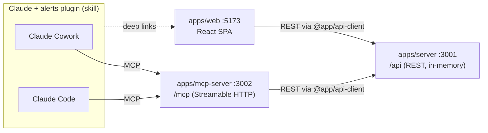

# Alerts Case Management Demo — Design

Date: 2026-11-17 · Status: draft for approval

Related: [Why MCP](../../why-mcp.md) · [Rehearsal workflows](../../rehearsal-workflows.md)

## 1. Intent

Show a compliance analyst at a hedge fund **starting alert investigations in Claude** (Cowork and Claude Code) instead of in the case management tool. Claude finds alerts, recommends what to do with one, and hands the analyst into the app through deep links. A follow-up phase renders key app views inside Cowork (MCP Apps) using the same UI components as the app.

The product is a demo, not a production system. It has to be realistic enough that the end-to-end workflows in `docs/rehearsal-workflows.md` run convincingly and identically every time.

**Two delivery modes, both first-class:**

1. **Standalone, linkable web app.** A complete case management UI in which every meaningful view has its own URL. It works with no Claude involved.
2. **Cowork UI integration (phase 2).** Selected views (alert card, alert list) render inside Cowork from MCP tool results, built from the same components as the app.

## 2. Goals, non-goals, anti-goals

**Goals**
- A full alert lifecycle in the web app: search and filter, view, comment, acknowledge, escalate, close, reopen, manage assignees, links and attachments.
- Every view addressable by URL. A link built by the MCP server reproduces exactly what Claude described.
- An MCP server (Streamable HTTP) with 6 read tools and 2 write tools. Every result carries deep links.
- **Claude acts as the user, and the architecture knows it.** Agent-originated requests are detected server-side (not self-declared) and marked `via: claude` everywhere.
- **An access queue in the app.** Claude's writes become pending action requests that the user approves or rejects in the web app before anything changes.
- A Claude plugin bundling the MCP connection and an `investigate-alert` skill.
- Deterministic seed data that supports rehearsal workflows W1–W6.
- Playwright end-to-end coverage of the web workflows and deep links.
- Phase 1 must leave phase 2 (an alert card and alert list rendered in Cowork through MCP Apps) unblocked: shared `@app/ui` components and structured tool results.

**Scope of this design and its plan: phase 1 only.** Phase 2 (§12, W6) gets its own design pass and plan once phase 1 runs.

**Non-goals**
- Authentication, authorisation, multi-tenancy.
- Durable persistence (state resets on server restart, by design).
- Real market data, real regulatory rule engines, or alert generation.
- stdio MCP transport. A CLI.
- An LLM in the backend (Claude produces the recommendations).
- Production deployment, mobile layouts, i18n.

**Anti-goals** (failures even if everything "works")
- A deep link that opens a view different from what Claude described (different filters, different counts).
- Claude changing an alert without the user approving it in the app (when approval is required).
- A Claude action that can't be told apart from a human one, or that Claude can approve itself.
- The Cowork card visibly diverging from the app's UI.
- A demo that behaves differently between rehearsal and the live run (non-deterministic seed, clock-dependent data).

## 3. Constraints

- TypeScript everywhere (Node backend, browser frontend).
- Lightweight, proven open-source dependencies.
- Monorepo.
- Web UI: React, shadcn/ui on Base UI with Tailwind v4, TanStack Router (URL state), TanStack Query (server state), Zustand (UI state). (Replaced Fluent UI v9 on 2026-11-17; see `2026-11-17-ui-shadcn-tailwind-design.md`.)
- REST API. No database: in-memory, with seed data, and the state lasts until restart.
- Playwright for end-to-end tests (the user has the Playwright skill installed).
- Local toolchain: Node 25, npm 11. pnpm is enabled through corepack.

## 4. Approaches considered

| Decision | Options | Chosen | Why |
| --- | --- | --- | --- |
| Claude integration | MCP server · CLI + skills · MCP + skill | **MCP over Streamable HTTP + plugin with a skill** | Only MCP leads to phase 2 (MCP Apps), it is how Cowork connects natively, and tool annotations give a confirmation step for writes. See `docs/why-mcp.md`. stdio was dropped (decided by the user). |
| Backend framework | Hono · Fastify + TypeBox · Koa · Express | **Hono + `@hono/zod-openapi`** | One Zod schema per route gives validation, types and the OpenAPI spec. Handlers use web-standard Request/Response and are testable without a server. Koa was considered and would need validation, typing and OpenAPI assembled by hand. Confirmed by the user. |
| API contract sharing | zod-openapi + generated client · Hono RPC `hc` · hand-written types | **Zod schemas in `@app/domain`, OpenAPI → `openapi-typescript` types → `openapi-fetch` client** | One source of truth that is also used for MCP tool input schemas. `hc` gives no spec and type checks slowly at scale. |
| UI sharing for MCP Apps | Presentational `@app/ui` package · embed web-app routes in the iframe | **Presentational package** | The same components render in the router app and in the single-file MCP App bundles. Embedding the app fights the iframe sandbox and its CSP and couples the card to the whole app. |
| Monorepo tooling | pnpm workspaces · + Turborepo · Nx | **pnpm workspaces + TS project references** | Enough at this size. Turborepo can be added if builds get slow. |
| MCP server placement | Separate process calling REST · mounted inside the backend | **Separate process calling REST** | Keeps "MCP is just another client" true. It exercises the same API as the web app. |

## 5. Architecture



### 5.1 Repository layout

```
/
├─ package.json            # root scripts: dev, build, test, e2e, typecheck, lint
├─ pnpm-workspace.yaml
├─ tsconfig.base.json      # strict, ES2023, moduleResolution bundler
├─ packages/
│  ├─ domain/              # @app/domain   — Zod schemas, types, state machine, link builder (pure, no I/O)
│  ├─ api-client/          # @app/api-client — openapi-fetch client + generated types
│  └─ ui/                  # @app/ui       — presentational shadcn/ui + Tailwind components (no router, no query)
├─ apps/
│  ├─ server/              # @app/server   — Hono REST API, in-memory store, seed
│  ├─ web/                 # @app/web      — Vite + React SPA
│  ├─ mcp-server/          # @app/mcp-server — MCP over Streamable HTTP
│  └─ mcp-ui/              # @app/mcp-ui   — (phase 2) Vite single-file MCP App bundles
├─ plugin/                 # Claude plugin: .claude-plugin/plugin.json, .mcp.json, skills/investigate-alert/SKILL.md
├─ e2e/                    # Playwright tests (or apps/web/e2e — builder's call)
└─ docs/
```

### 5.2 Runtime and config

| Process | Port | Key env |
| --- | --- | --- |
| `apps/server` | 3001 | `PORT`, `SEED` (Faker seed, default fixed), `AGENT_TOKEN` (must match the MCP server's) |
| `apps/web` (Vite dev) | 5173 | proxies `/api` → 3001 |
| `apps/mcp-server` | 3002 | `API_BASE_URL=http://localhost:3001`, `APP_BASE_URL=http://localhost:5173`, `ACTING_USER_ID` (the user Claude acts for), `AGENT_TOKEN` |

`pnpm dev` starts all three (via `concurrently` or pnpm's `--parallel`). `APP_BASE_URL` is the single source of the link origin.

## 6. Domain model (`@app/domain`)

All types are Zod schemas with inferred TS types. IDs are human-readable (`ALT-1042`, `U-01`).

**User**: `id`, `name`, `role` (`analyst` | `senior_analyst` | `compliance_lead` | `cco`), `desk?`, `initials`.

**Alert**
- `id`, `title`, `summary` (one paragraph), `description` (Markdown)
- `status`: `open` | `in_progress` | `closed`
- `severity`: `low` | `medium` | `high` | `critical`
- `category`: `spoofing_layering` | `wash_trade` | `position_limit` | `best_execution` | `restricted_list` | `late_reporting` | `insider_dealing` | `marking_the_close`
- `rule`: `{ id, name, regulation, indicators: Array<{ id, description, threshold }> }` (for example `{ id: "MAR-12-1a", name: "Layering indicator", regulation: "EU MAR Art. 12", indicators: [{ id: "otr", description: "Order-to-trade ratio", threshold: "> 20:1" }, …] }`). Rules are a fixed catalogue in the seed. *(My call: indicators and thresholds are data returned by `get_alert`, so Claude tests the data tab against the same criteria on every run; the skill only says how to use them.)*
- `desk` (for example `EU Equities`, `US Rates`, `FX`, `Commodities`), `trader: { id, name }`, `instrument: { symbol, name, assetClass }`
- `assignees`: `{ primaryId, backupId, escalatedTo: Array<{ userId, at, byUserId, reason }> }` — escalation **adds** people here
- `highlights`: `Array<{ label, value, tone?: 'neutral' | 'warning' | 'danger' }>` (the "summary highlight attributes")
- `dataTabs`: `Array<{ id, title, columns: Array<{ key, label, type: 'string' | 'number' | 'datetime' | 'currency' }>, rows: Record<string, string | number>[] }>`
- `links`: `Array<{ id, title, url, addedBy, addedAt }>`
- `attachments`: `Array<{ id, filename, mimeType, sizeBytes, uploadedBy, uploadedAt }>`
- `resolution?`: `{ outcome: 'false_positive' | 'true_positive' | 'duplicate' | 'other', note, closedBy, closedAt }`
- `createdAt`, `updatedAt`

**TimelineEvent**: `id`, `alertId`, `at`, `actorId`, `via: 'app' | 'claude'`, `actionRequestId?`, `approvedBy?`, and a discriminated `type`:
`created` · `comment {body}` · `status_changed {from, to, reason?}` · `escalated {toUserId, reason}` · `assignees_changed {primaryId, backupId}` · `link_added {linkId}` · `attachment_added {attachmentId}` · `action_requested {requestId, kind}` · `action_rejected {requestId, reason}`.

**ActionRequest** (the access queue): `id` (`AR-0001`), `alertId`, `kind: 'add_comment' | 'acknowledge'`, `payload` (the validated request body for that kind), `onBehalfOf` (userId), `via: 'claude'`, `rationale` (Claude's one-to-three-sentence reason, required), `status: 'pending' | 'approved' | 'rejected' | 'failed'`, `createdAt`, `decidedAt?`, `decidedBy?`, `rejectReason?`, `failure?` (`{ code, message }`), `resultEventId?`.

**UserSettings**: `requireApprovalForAgentActions: boolean` (default `true`).

**State machine** (pure function in domain, enforced by the server):

| From | Action | To | Requires |
| --- | --- | --- | --- |
| open | acknowledge | in_progress | — |
| in_progress | close | closed | `outcome` + `note` |
| closed | reopen | open | `reason` |
| open / in_progress | escalate | (unchanged) | `toUserId`, `reason`. The target must not already be escalated |
| closed | escalate | — | not allowed |

Comments, links and attachments are allowed in every status. *(My call: reopen returns to `open` so the alert needs acknowledging again, and close is only allowed from `in_progress`, as the lifecycle in the request describes.)*

`allowedActions(alert)` is exported and returned by the API so that the UI and Claude both know what is possible.

**Link builder** (`@app/domain/links`): `alertListUrl(base, filters)`, `alertUrl(base, id, { tab?, dataTab? })`. It is pure and shares its search-param schema with the web router (section 8). It is used by the MCP server and covered by a parity test.

## 7. REST API (`apps/server`)

Base path `/api`. JSON. Errors use `{ error: { code, message, details? } }` with 400 (validation), 404, 409 (illegal transition).

**Identity and agent detection** (middleware builds a request context `{ userId, via }`):
- `X-User-Id` names the user (required for writes, must exist). In the web app it comes from the demo user switcher. *(This is not authentication. It's a demo affordance.)*
- `Authorization: Bearer <AGENT_TOKEN>` marks the request as coming from Claude: the context becomes `via: 'claude'`. Without a valid token, `via` is always `'app'`. There is no header a client can set to claim or hide agent origin.
- Claude always acts **as the user** (`userId` = the user it acts for); `via` is what distinguishes it. Every timeline event and action request records both.
- Requests with the agent token get **403** on approve/reject and on settings changes. Claude can never approve its own requests.

**Access queue.** For a write from `via: 'claude'` when the acting user has `requireApprovalForAgentActions: true`, the write endpoint validates the body and pre-checks the state machine, then **does not apply it**: it creates a pending ActionRequest, records an `action_requested` timeline event, and returns **202** `{ actionRequest }`. With the setting off, the write applies immediately (200) and is still marked `via: 'claude'`. On approval the server re-checks the state machine against the current alert: if still legal, it applies the write as `{ actorId: onBehalfOf, via: 'claude', actionRequestId, approvedBy }`; if not (for example someone already acknowledged), the request becomes `failed` with the reason. Only `add_comment` and `acknowledge` are agent-allowed writes in phase 1; agent calls to other write endpoints get 403. Agent write bodies carry an extra `rationale` field.

| Method | Path | Notes |
| --- | --- | --- |
| GET | `/alerts` | Query: `status[]`, `severity[]`, `category[]`, `desk[]`, `assigneeId`, `traderId`, `instrument`, `from`, `to` (createdAt), `updatedFrom`, `updatedTo`, `involvedUserId` (user is an assignee or an actor on any timeline event), `q` (free text), `sort` (`createdAt` \| `updatedAt` \| `severity`, with a `-` prefix for descending), `page`, `pageSize` (max 100). Returns `{ items: AlertSummary[], total, page, pageSize }`. |
| GET | `/alerts/:id` | Full alert + `allowedActions`. |
| GET | `/alerts/:id/timeline` | Oldest first. |
| GET | `/alerts/:id/related` | Alerts that share the trader, instrument or rule, each with a `matchedOn[]` and the resolution if closed. Default window 90 days. |
| POST | `/alerts/:id/comments` | `{ body }` |
| POST | `/alerts/:id/acknowledge` | — |
| POST | `/alerts/:id/close` | `{ outcome, note }` |
| POST | `/alerts/:id/reopen` | `{ reason }` |
| POST | `/alerts/:id/escalations` | `{ toUserId, reason }` |
| PUT | `/alerts/:id/assignees` | `{ primaryId, backupId }` |
| POST | `/alerts/:id/links` | `{ title, url }` |
| POST | `/alerts/:id/attachments` | multipart. Stored in memory, 5 MB cap. |
| GET | `/attachments/:id/content` | Streams stored bytes. Seeded attachments have generated placeholder content (small PDF/CSV/TXT). |
| GET | `/action-requests` | Query: `status[]`, `alertId`, `onBehalfOf`. Newest first. |
| GET | `/action-requests/:id` | Includes the alert summary and, once applied, the resulting event. |
| POST | `/action-requests/:id/approve` | Human only (403 for the agent token). Only `onBehalfOf` may approve. Returns the applied result or the failure. |
| POST | `/action-requests/:id/reject` | Human only. `{ reason? }` |
| GET / PUT | `/users/:id/settings` | `{ requireApprovalForAgentActions }`. PUT is human only. |
| GET | `/users` | — |
| GET | `/meta` | Enum values + distinct desks, rules and traders for filter dropdowns. |
| POST | `/admin/reset` | Re-seeds the store. Used by tests and rehearsal. |
| GET | `/openapi.json` | Generated by zod-openapi. |

**Store:** `Map`s for alerts, timeline, users and attachments behind small repository functions. No ORM.

**Search:** structured filters are applied first. Then `q` runs through a MiniSearch index over title, summary, description, trader name, instrument, rule name and comment bodies, with prefix and fuzzy matching (fuzzy 0.2). The index is updated on writes. When `q` is present and no sort is given, results are ordered by relevance.

**Seed** (`apps/server/src/seed`): about 45 background alerts generated with Faker on a fixed seed, plus hand-written **story records** for the rehearsal workflows (ALT-1042, the T-0412 history, ALT-0987, ALT-1051, and the EU Equities set for W1; see the rehearsal doc). It includes 6 users covering every role. All timestamps are computed **relative to server start** (for example "3 weeks ago"), so the relative claims in demos hold on any day.

## 8. Web app (`apps/web`)

**Stack:** Vite, React 19, shadcn/ui on Base UI with Tailwind v4 (neutral theme, light by default with a dark toggle), TanStack Router (file-based or code-based, the builder's call), TanStack Query, Zustand.

**State ownership** (enforced by convention and review):

| State | Owner | Examples |
| --- | --- | --- |
| Anything that should survive a shared link | URL (TanStack Router search params, validated with Zod from `@app/domain`) | filters, `q`, sort, page, selected alert, active tab |
| Server data | TanStack Query | alert lists, alert detail, timeline, users, meta |
| Local UI preferences | Zustand (persist to localStorage where noted) | current demo user (persisted), theme (persisted), list density, panel sizes |

Filters never live in Zustand.

**Routes**

| Path | Search params | View |
| --- | --- | --- |
| `/` | — | redirect → `/alerts` |
| `/alerts` | `status`, `severity`, `category`, `desk`, `assigneeId`, `traderId`, `instrument`, `from`, `to`, `q`, `sort`, `page` | Filter bar (structured filters + free-text search box), results table (DataGrid), count, pagination. "Assigned to me" quick filter. |
| `/queue` | `status` (default `pending`) | The access queue: Claude's pending requests for the current user, each with the alert, the action, Claude's rationale and the exact payload (for example the comment text), plus Approve and Reject. Decided requests are listed under other statuses. |
| `/queue/$requestId` | — | One request, deep-linkable from Claude's reply. Approve/Reject, then a link to the alert. |
| `/alerts/$alertId` | `tab` = `overview` \| `timeline` \| `materials` \| `data`; `dataTab` = data tab id | Header (title, status badge, severity, rule, allowed-action buttons), highlights strip, assignees panel, tabs. |

- Overview: summary, description, highlights.
- Timeline: events, comment composer, and "via Claude" marked on entries.
- Materials: links and attachments, with add/upload.
- Data: data-tab picker and table.

Actions (acknowledge, close, reopen, escalate, edit assignees) open dialogs and collect the required fields. Mutations invalidate the alert, timeline and list queries.

**Header:** a demo user switcher (Zustand) that sets `X-User-Id` on every API request, and a **Queue** item with a count of the current user's pending requests (TanStack Query, `refetchInterval` about 3 s; no push).

**Agent visibility:** timeline entries made by Claude carry a "via Claude" marker and, where approved, "approved by <name>". An alert with pending requests shows a banner with Approve/Reject inline. A settings panel (from the user menu) has the "Require approval for Claude's actions" toggle.

**Deep-link contract:** `@app/domain/links` and the router's `validateSearch` use the same Zod schema. A unit test checks that `parse(build(x)) === x`, and a Playwright test opens builder-generated URLs and checks the rendered filters, counts and tab.

## 9. Shared UI (`packages/ui`)

Presentational shadcn/ui + Tailwind components with **data-in, callbacks-out** props. They take no router, React Query or Zustand imports, and fetch nothing. The web app wraps them in containers. Phase 2 bundles wrap them with the MCP Apps bridge.

Initial components: `AlertStatusBadge`, `SeverityBadge`, `AlertHeader` (with `actions` and `onAction`), `AlertHighlights`, `AssigneesPanel`, `AlertTimeline`, `AlertSummaryCard` (the Cowork card: header + highlights + last 3 timeline entries + an "Open in app" slot), `AlertTable` (sortable list), `DataTabTable`, `ActionRequestCard` (action, rationale, payload preview, Approve/Reject callbacks). The request card is shared so phase 2 can show it in Cowork.

Rule: if a view appears in Cowork, its visual parts live in `@app/ui`. This is what keeps the card identical to the app.

## 10. MCP server (`apps/mcp-server`)

**Stack:** `@modelcontextprotocol/sdk` with the Streamable HTTP transport, mounted at `POST/GET /mcp` on a small Hono app (`@hono/mcp` or the SDK's Node transport, whichever the builder's version check finds cleanest). Stateless mode is acceptable.

**Identity:** every API call sends `X-User-Id: $ACTING_USER_ID` and `Authorization: Bearer $AGENT_TOKEN`. Claude acts as that user; the backend detects agent origin from the token. The web app's default user is the same `ACTING_USER_ID`, so the presenter approves their own Claude's requests.

**Tools.** Input schemas come from `@app/domain` Zod schemas. Each returns a concise text summary for the model plus `structuredContent` that includes `url` deep links.

| Tool | Annotations | Behaviour |
| --- | --- | --- |
| `search_alerts` | readOnly | Filters + `q` (same shape as `GET /alerts`). Returns the top N summaries (default 10), `total`, and `listUrl` that reproduces the same query in the app. |
| `get_alert` | readOnly | Full alert + `allowedActions` + `url` (and per-tab URLs). |
| `get_alert_timeline` | readOnly | Events with actor names resolved. |
| `find_related_alerts` | readOnly | Related alerts with `matchedOn` and resolution. |
| `list_users` | readOnly | Users and roles. |
| `add_comment` | readOnly: false, destructive: false | Input: `alertId`, `body`, `rationale`. Returns either `{ status: 'pending_approval', requestId, approveUrl }` (queue on) or the applied event + `url` to the timeline tab. |
| `acknowledge_alert` | readOnly: false, destructive: false | Input: `alertId`, `rationale`. Same return shape as above. |
| `get_action_request` | readOnly | Status of a request Claude submitted (pending / approved / rejected with reason / failed with reason), with the resulting event and links. |

Tool descriptions stay short. The investigation method lives in the skill. Write tool results tell Claude plainly that nothing has changed yet and that the user must approve in the app at `approveUrl`.

## 11. Claude plugin (`plugin/`)

- `.claude-plugin/plugin.json`: name `alerts-demo`, description, version.
- `.mcp.json`: an HTTP server `alerts` → `http://localhost:3002/mcp`.
- `skills/investigate-alert/SKILL.md`: the playbook. Gather context (get_alert, timeline, related) → test the data tabs against the rule's indicators → recommend exactly one next action (close as false positive / escalate to X / request more information) with supporting facts, a counter-fact and a confidence level → always give deep links → offer to acknowledge and post the recommendation as a comment; if the user agrees, submit the request(s) with a rationale, give the approval link, and never describe the change as done until `get_action_request` says it was approved.
- It should be installable in Claude Code (local marketplace or `--plugin-dir`) and in Cowork. **The exact way to install it in Cowork must be verified in the first spike.**

## 12. Phase 2 — MCP Apps (follow-up, sketched here)

Superseded by `2026-11-17-mcp-apps-phase2-design.md`, which moves approval onto the Cowork request card.

- `apps/mcp-ui` builds one self-contained HTML file per view (`alert-card.html`, `alert-list.html`) with Vite + `vite-plugin-singlefile`, importing `@app/ui` and the MCP Apps client SDK (`@modelcontextprotocol/ext-apps`).
- The MCP server registers them as `ui://alerts/alert-card` and `ui://alerts/alert-list` resources. `get_alert` and `search_alerts` declare the UI resource in their tool metadata.
- In the iframe, data arrives through the tool result (`structuredContent`). Actions call server tools through the bridge, and "Open in app" uses the host's open-link capability with the same deep link. No direct network access from the iframe.
- Phase 2 can render `ActionRequestCard` in Cowork so the user approves in place, still through the same `/action-requests/:id/approve` path.
- Phase 2 adds UI-initiated tools for escalate, close and reopen (the human clicks the button in the card). Whether those are hidden from the model is decided when phase 2 is designed.
- The phase 1 design must not block this. That's why §9 exists and why tool results are already structured.

## 13. Testing

| Layer | Tool | Covers |
| --- | --- | --- |
| `@app/domain` | Vitest | state machine (every legal and illegal transition), link builder round-trip, schema parsing |
| `apps/server` | Vitest + `app.request()` | every route, filter combinations, free-text search, 409s, identity stamping, reset; agent detection (no token = `app`, spoofing impossible), queue: 202 + pending request, approve applies with correct attribution, stale approve fails, reject, agent token 403 on approve/settings/other writes, setting off applies directly |
| `apps/mcp-server` | Vitest + MCP SDK client against a server started on a test port | each tool's output shape, deep links valid, write tools return `pending_approval` with a working `approveUrl`, `get_action_request` reflects decisions |
| `apps/web` | Playwright (Chromium) | W1–W4 app-side flows: filter + search via URL, alert detail tabs, comment, acknowledge, escalate, close, reopen, assignee edit, link/attachment add; deep links from the link builder render the expected state; the access queue (badge count, approve from `/queue/$requestId` and from the alert banner, reject with reason, timeline shows "via Claude · approved by"), using requests created through the API with the agent token. Calls `/api/admin/reset` before each test. |
| `packages/ui` | — (exercised through Playwright). Component tests are optional. |

TDD for domain and server logic.

**Workflow independence** *(my call)*: every rehearsal workflow and every Playwright test starts from `POST /api/admin/reset`; none depends on another having run. Consequences for the seed:
- ALT-1042 starts **Open** (W1, W2; W6 later).
- W3 escalates the **in-progress** earlier T-0412 alert, not ALT-1042; the deep link goes to that alert's overview, where the assignees panel lives (there is no separate assignees tab).
- W5 does not need W2–W4: the seed includes timeline activity by the demo user timestamped earlier "today" (relative to server start), and the handover uses `involvedUserId` + `updatedFrom`.

## 14. First spike (before building on assumptions)

A throwaway check that a Streamable HTTP MCP server on `localhost` (one hello-world tool returning a link) is reachable from **Cowork** and **Claude Code**, and that the plugin installs in both. If localhost doesn't work from Cowork, decide between a tunnel and another option before building `apps/mcp-server`. Also note whether Cowork prompts before calling a non-read-only tool; the access queue makes approval independent of that, but it affects how the demo flows.

## 15. Left to the builder

- File-based vs code-based TanStack Router routes. Exact component layout and visual polish within shadcn defaults.
- Exact background seed content (it must stay realistic for hedge fund trade surveillance and deterministic).
- Lint/format setup (decided: oxlint for linting, oxfmt for formatting).
- Whether `e2e/` lives at the root or inside `apps/web`.
- Pagination style and default page size.
- `@hono/mcp` vs the SDK's Node transport, after checking the current versions.
