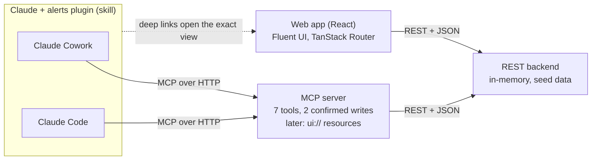

# Why MCP for the Alerts Case Management Demo

> Snapshot of the living doc at https://claude.ai/artifact/NudE9J7KA1VPqt1sw1JR57 (2026-11-17). The living doc is the source of truth; refresh this copy when it changes.

## Summary

We connect Claude to the alerts app through **one MCP server over Streamable HTTP**, packaged with a **Claude plugin** that carries an alert-investigation skill. We are not building a CLI, and we are not offering a stdio transport.

The main reason is that MCP is the only way to reach the interactive UI phase. MCP Apps renders UI from MCP tool results, so any other route would be rebuilt when that phase starts. MCP is also the native way to connect to Cowork, and it lets clients ask the user to confirm before Claude changes an alert.

## Context

The demo shows a compliance analyst at a hedge fund **starting an investigation in Claude** instead of in the case management app. The analyst asks Claude to find alerts, asks for a recommendation on one, and moves into the web app only when they want to act.

The integration is phased:

1. **Deep links.** Claude answers questions and recommends actions. Every answer links to the exact view in the web app, such as a filtered list, an alert, or a tab on an alert. This works the same in Cowork and Claude Code.
2. **Interactive UI (follow-up).** In Cowork, key views (the alert card, the alert list) render inline using the same React components as the web app. The user can act there or follow the link.

The system has four parts, all in TypeScript: a REST backend with an in-memory store and seed data, a React web app, an MCP server, and later the MCP Apps UI bundles.

Claude never talks to the backend directly. The MCP server is a thin layer over the REST API, and the dashed path is how the user moves from Claude into the app.

## Options considered

We compared three ways for Claude to reach the app. MCP plus a skill comes out ahead on every point that matters for this demo except context cost.

| Criterion | MCP server | CLI + skills | MCP + skill (chosen) |
| --- | --- | --- | --- |
| Works in Cowork | Native, as a connector | Needs the CLI installed in Cowork's sandbox and network access back to the server | Native |
| Works in Claude Code | Yes, over HTTP | Yes, very well | Yes |
| Path to interactive UI in Cowork | Direct: MCP Apps | None; would be rebuilt as MCP | Direct |
| Confirmation before a write | Tool annotations; the client prompts the user | Relies on Bash permission prompts, which don't know what the command does | Tool annotations |
| Teaching an investigation workflow | Squeezed into tool descriptions | Skill instructions | Skill instructions |
| Context cost | Every tool schema loads up front | Low: help text is read on demand | Kept low by having few tools |
| Testability | Integration tests with the MCP client SDK | Easy: plain shell output | Both share one typed API client |

## Why MCP

- **It is the only route to phase 2.** MCP Apps is an extension of MCP. A tool result points to a `ui://` resource, and Cowork renders that HTML in a sandboxed iframe that can call tools back. Any other route would be rebuilt as MCP when phase 2 starts.
- **It is how Cowork connects to outside systems.** Cowork uses connectors, which are MCP servers. A CLI would have to be installed inside Cowork's sandbox and reach our server over the network, and that is fragile in a live demo.
- **Writes are confirmed with no extra code.** Tools carry hints such as `readOnlyHint` and `destructiveHint`. Clients use them to ask the user before a write runs, which fits a compliance setting where Claude advises and a human approves.
- **One server serves both clients.** Cowork and Claude Code use the same tools, links and audit trail, so we demo the same behaviour in both.
- **Results are structured.** Tools return a short text summary for Claude plus `structuredContent` (typed JSON with deep links). Phase 2 UI renders that same JSON, so we don't need a second contract.

## Where the skill fits

MCP tools give Claude the actions it can take. The skill tells it how an investigation should go. Both ship together in one Claude plugin, which also holds the MCP connection config, so installing the plugin sets everything up.

The `investigate-alert` skill covers:

1. Pull the full alert context: details, history, data tabs.
2. Check related alerts on the same trader, instrument or rule over the last 90 days.
3. Go through the cited rule's criteria (for example, the MAR market manipulation indicators) against the data.
4. Recommend one next action (close as false positive, escalate, or request more information), with reasons and a confidence level.
5. Always include deep links. Offer to post the recommendation as a comment, and only do so after the user confirms.

Keeping this in a skill means tool descriptions stay short and the schemas take less context. We can also change the playbook without touching server code.

## What we are not doing

| Not doing | Why |
| --- | --- |
| stdio transport | Both clients can use HTTP. A second transport doubles the setup docs and the test matrix for no gain in the demo. |
| A CLI | It only helps Claude Code, and it adds nothing to phase 2. It's a day's work on top of the shared API client if we want it later. |
| Full write parity with the app | In a compliance setting, "Claude closed the alert" is a hard sell. Writes stop at commenting and acknowledging, both confirmed by the user and recorded as "via Claude". |
| An LLM in the backend | Claude writes the recommendations. The backend only serves data that is rich enough to reason about. |

## Risks and open questions

| Risk | Mitigation |
| --- | --- |
| We haven't confirmed that Cowork can reach an MCP server on localhost | Build a throwaway hello-world tool in week 1 that returns a deep link. If localhost doesn't work, fall back to a tunnel (for example, cloudflared) for the demo. |
| Deep links only resolve on the presenter's machine | Configure the app's base URL in one environment variable shared by the MCP server and the web app. Demo on one machine. |
| Tool schemas use up context | Keep the tool set to 8 or fewer, with short descriptions. Workflow detail lives in the skill. |
| Identity for actions taken "via Claude" | No real auth. The MCP server acts as a configured demo user, and every write is recorded with `via: "claude"` so the timeline shows it. |
| MCP Apps support in each client may change | Phase 1 depends only on text and links. Phase 2 falls back to the deep link when the client can't render UI. |

## Proposed tool surface

There are seven tools: five that read and two that write after confirmation. Every result includes a `url` that deep links into the web app.

| Tool | Kind | Returns |
| --- | --- | --- |
| `search_alerts` | read | Matching alerts for structured filters (status, severity, rule, assignee, trader, desk, date range) plus free text, with a link to the same filtered list view |
| `get_alert` | read | Full alert: summary, highlight attributes, assignees, links, attachments, data tabs, allowed next actions |
| `get_alert_timeline` | read | Comments, status changes and escalations, oldest first |
| `find_related_alerts` | read | Alerts that share a trader, instrument or rule, with how they were resolved |
| `list_users` | read | People who can be assigned or escalated to, with their roles |
| `add_comment` | write, confirmed | The new timeline entry, recorded as via Claude |
| `acknowledge_alert` | write, confirmed | The alert moved from Open to In Progress |

Escalate, close and reopen stay in the web app for phase 1. In phase 2 they move to the interactive UI in Cowork, where the human clicks the button.
